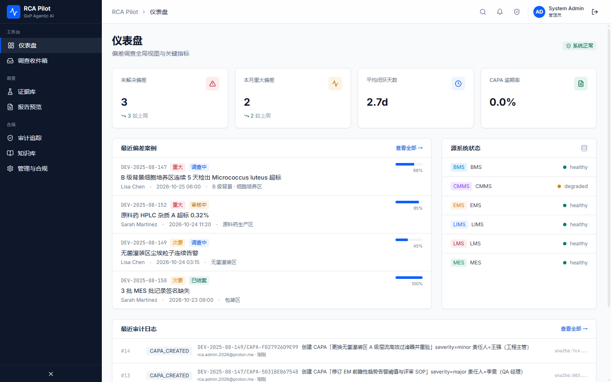
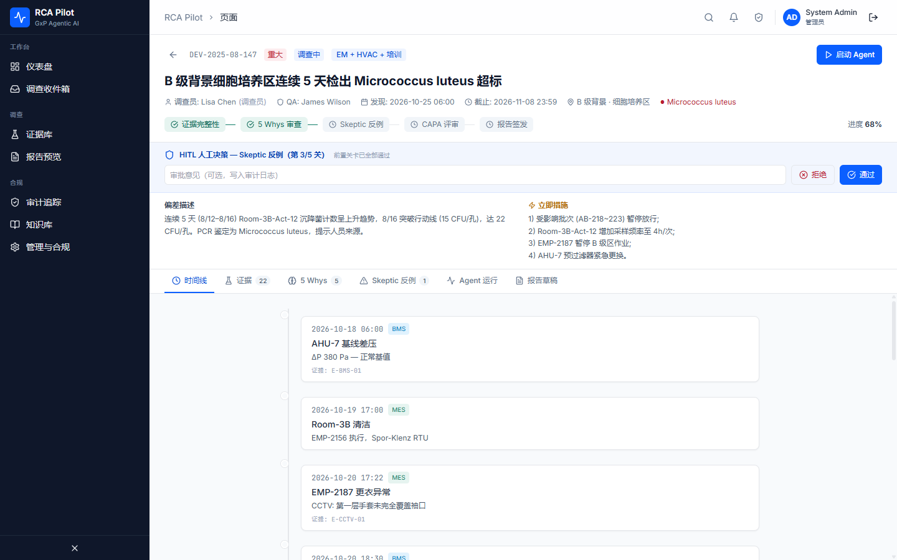
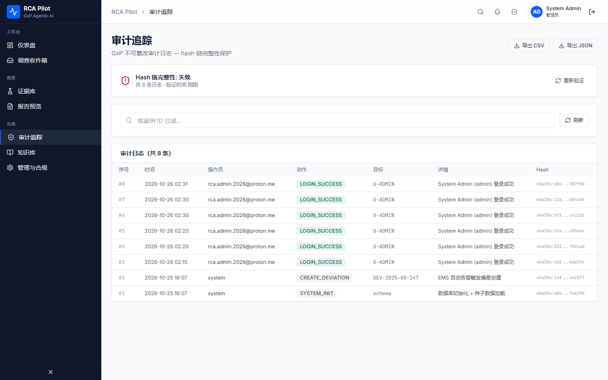

# RCA Pilot

> 受 GxP 监管的 Agentic AI 偏差调查平台：从偏差告警接入到 ICH Q9 报告双人签发的完整闭环。




| 调查工作台 | 审计追踪 |
|---|---|
|  |  |

## 为什么做

生物制药的偏差调查依赖人工拼接 LIMS/EMS/MES 等系统证据，一份可审计的根因报告常以周计。RCA Pilot 用多 Agent 编排替代这段人工流程：证据自动聚合、双 Reasoner 博弈推理、Skeptic 交叉质证，目标 4 小时内交付 ALCOA+ 可审计草稿，每一步都有 hash 与人工门控兜底。

## 功能特性

- **端到端闭环**：偏差 → 证据聚合 → 根因 → CAPA → ICH Q9 报告 → 21 CFR Part 11 双人电子签发
- **多 Agent 博弈**：6 Agent 流水线（Meta-Controller → Evidence Hunter → Reasoner → Skeptic → Drafter → Guardian）；双 Reasoner 跨 LLM 对抗，Skeptic 质证，0.0–1.0 置信度加权结论
- **5 道 HITL 门控**：证据 / 5 Whys / 反例 / CAPA / 签发，逐关审批不可跳过
- **语义证据检索**：Embedding 余弦相似度，自动降级关键词检索，跨案例关联
- **GxP 内建**：SHA-256 hash 链审计 + DB 层 RULE 防篡改、双人签名、LLM 调用全量留痕
- **LLM 永不阻塞**：统一客户端（GLM/Qwen/OpenAI/Anthropic/Azure），未配置或异常时三级降级规则路径

## 快速开始

```bash
git clone https://github.com/cgs123456/RCA-pilot.git && cd RCA-pilot/deploy
cp .env.example .env                    # dev 默认值可直接跑通
docker compose up -d --build            # 3 后端单元 + 前端 + PostgreSQL(pgvector) + Redis
docker compose --profile seed up seed   # 首次：写入演示数据（8 用户 / 4 案例 / 证据与审计流）
```

打开 <http://localhost:8080>，用下方演示账号登录。

### 演示账号

| 角色 | 邮箱 | 密码 |
|---|---|---|
| 调查员（Lisa Chen） | `lisa.chen@biopharma.com` | `rca-demo-2025` |
| QA 审核员（James Wilson） | `james.wilson@biopharma.com` | `rca-demo-2025` |
| 管理员 | `admin@biopharma.com` | `rca-admin-2025` |

种子共 8 个用户（含运营经理与操作员），凭据定义见 `backend/seed.py`。

<details>
<summary>本地开发（不用 Docker 编排业务服务）</summary>

```bash
# 1. PostgreSQL（需 pgvector 镜像）
docker run -d --name rca-pg -e POSTGRES_USER=rca -e POSTGRES_PASSWORD=rca-secret \
  -e POSTGRES_DB=rca_pilot -p 5432:5432 pgvector/pgvector:pg15

# 2. 后端（Python ≥3.11）
cd backend && pip install -r requirements.txt
alembic upgrade head          # 用 alembic 命令行；python -m alembic 会与本仓库 alembic/ 包冲突
python seed.py
POSTGRES_HOST=localhost uvicorn core_service.main:app --port 8000   # auth/case/evidence/audit
POSTGRES_HOST=localhost uvicorn agent_service.main:app --port 8004  # Agent 流水线
POSTGRES_HOST=localhost uvicorn connectors.gateway:app --port 8010  # LMS/BMS/EMS/MES

# 3. 前端（Node ≥18）：npm install && npm run dev → http://localhost:5173（/api 已代理）
```

</details>

## 架构

```
      React 18 + Vite (Nginx :8080)
                   │ /api/v1
   ┌───────────────┼────────────────┐
 core-service  agent-service  connector-gateway
    :8000         :8004           :8010
 业务路由聚合   6-Agent 流水线  LMS/BMS/EMS/MES 连接器
   └───────────────┼────────────────┘
      PostgreSQL 15 + pgvector · Redis · LLM×5 Providers
```

## 环境变量

| 变量 | 必填 | 说明 |
|---|---|---|
| `POSTGRES_PASSWORD` | 是 | prod fail-fast 校验非默认值 |
| `JWT_SECRET` / `SERVICE_API_KEY` | 生产是 | 签名密钥 / 服务间鉴权 |
| `LLM_PROVIDER` / `LLM_API_KEY` | 否 | 未配置自动走规则降级路径 |
| `RCA_FEATURE_FLAGS` | 否 | 6 个 flag 按用户 hash 灰度 |

完整清单见 [deploy/.env.example](deploy/.env.example)。

## 测试

```bash
cd backend && pip install -r requirements.txt
python -m pytest tests/ -q    # 617 passed · coverage 门槛 80%（当前 88.9%）
ruff check . && mypy .        # CI 同款 lint + 类型检查
```

CI 依次执行 ruff → mypy → pytest → 前端 tsc/build → alembic 迁移一致性检查。

## 安全

本项目为演示/试点环境设计，请勿接入生产数据。安全漏洞请通过 [Issues](https://github.com/cgs123456/RCA-pilot/issues) 私密联系维护者，勿公开披露。

## 贡献

见 [CONTRIBUTING.md](CONTRIBUTING.md)。

## 许可

UNLICENSED — Internal use only。未经授权不得分发。
